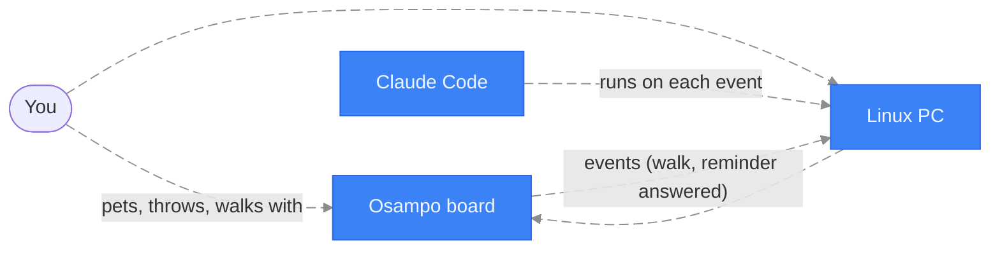
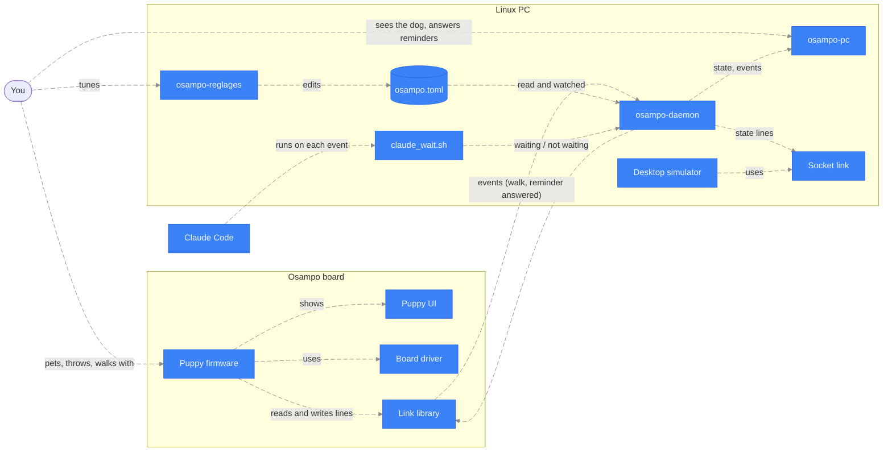
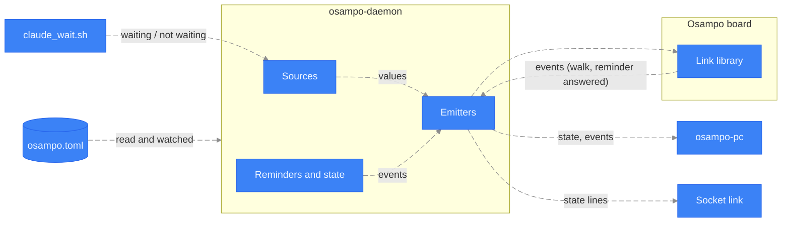

# Architecture

Generated from the LikeC4 model [`docs/architecture/osampo.c4`](architecture/osampo.c4) by `tools/architecture.sh`. Do not edit by hand.

*Généré depuis le modèle LikeC4 par `tools/architecture.sh` : ne pas modifier à la main.*

## Context

## Inside the board and the PC

## The daemon

## When Claude Code waits

```mermaid
graph LR
  Claude["Claude Code"]
  PcHook["claude_wait.sh"]
  PcDaemonSources["Sources"]
  PcDaemonEmitters["Emitters"]
  BoardLinkB["Link library"]
  BoardFirmware["Puppy firmware"]
  User(["You"])
  PcTrayApp["osampo-pc"]
  Claude -. "Notification / Stop hook" .-> PcHook
  PcHook -. "writes 1" .-> PcDaemonSources
  PcDaemonSources -. "claude_wait=1" .-> PcDaemonEmitters
  PcDaemonEmitters -. "state line, by Bluetooth or USB" .-> BoardLinkB
  BoardLinkB -. "claude_wait=1" .-> BoardFirmware
  BoardFirmware -. "puppy sits and scratches the screen" .-> User
  PcDaemonEmitters -. "claude_wait=1" .-> PcTrayApp
  PcTrayApp -. "paw on the tray dog" .-> User
  classDef primary fill:#3b82f6,stroke:#2563eb,color:#eff6ff
  class Claude,PcHook,PcDaemonSources,PcDaemonEmitters,BoardLinkB,BoardFirmware,PcTrayApp primary
  linkStyle 0,1,2,3,4,5,6,7 stroke:#8D8D8D,stroke-dasharray:8 4
```

