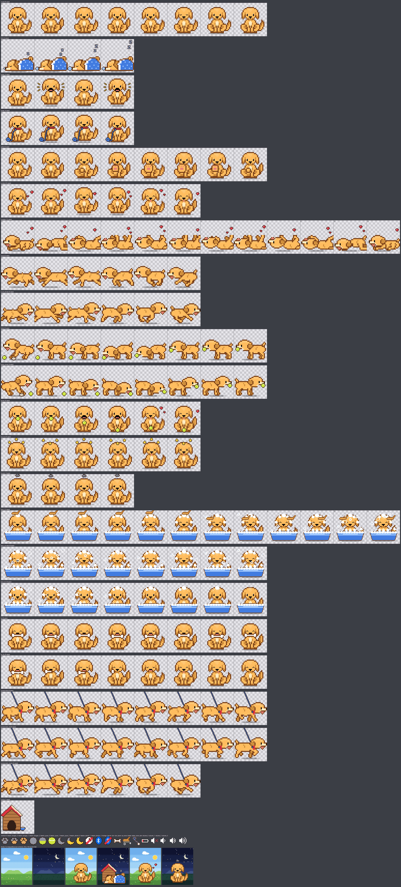
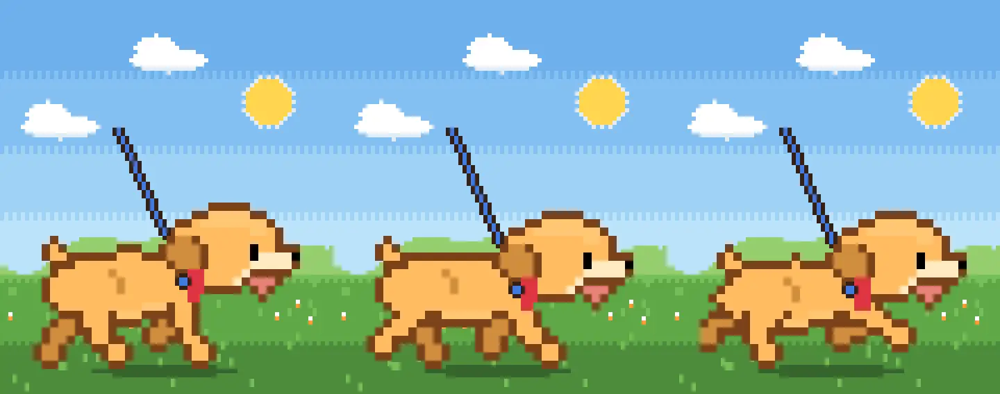

# Comment les sprites sont fabriqués

*[English version](sprites.md)*

Toutes les images du chiot sont **générées par du code** : `widgets/osampo/tools/gen_assets.py`
dessine chaque pose pixel par pixel et écrit les planches. Personne ne retouche un PNG à la
main : changer une pose, c'est changer le code et régénérer.



## Les contraintes de la board

- **Écran :** 240 × 284 pixels, 1,83". Une pose tient dans une **case de 64 × 64**,
  affichée ×3.
- **Planches :** une bande horizontale par animation (`ui/sprites/<anim>.png`), 6 à 8 cases,
  jouées à 70 à 200 ms par case.
- **Couleurs :** **16 au plus par planche** (vérifié par le générateur), pour que les
  planches restent légères en flash.
- **Sons :** WAV mono, 16 kHz, 16 bits, sur un petit haut-parleur. Chaque son est gardé
  entier : un extrait trop court donne un « pac » saturé.

## Deux chiots, une palette

- **De face** (assis, aboie, patte contre l'écran, bain, os…) : dérivé du chiot assis de
  **strawheart** (*Animals and Tea*, CC-BY-SA 3.0). L'original de 23 × 25 est agrandi ×2,
  puis retouché pixel par pixel : yeux redessinés à la résolution de la case, gueule,
  langue, pattes, accessoires, ombre au sol. Ces planches restent sous **CC-BY-SA 3.0**
  ([crédits](../LICENSE-ASSETS.md)).
- **De profil** (dort, court après la balle, roulade, promenade) : dessiné de zéro dans le
  générateur. Seule la palette de strawheart est reprise, pour que les deux vues aillent
  ensemble. Des photos et dessins de vrais chiens ont servi de modèles de poses, sans copie
  de pixels.

## La promenade : pas, trot, galop

En promenade, la board compte tes pas et le chiot suit ton allure.



Le cycle de marche suit les principes d'un tutoriel de cycle de marche de chien en pixel art
de **Slynyrd** :

- **Pattes droites au sol, pliées seulement en l'air.** Une patte posée est une ligne droite
  de l'épaule ou de la hanche jusqu'au pied ; le poignet se replie et le jarret se plie
  seulement pendant que la patte revient vers l'avant.
- **La croupe au-dessus des pattes arrière.** Les pattes arrière sont sous la croupe, pas
  sous le ventre ; sinon le chiot semble traîner quelque chose.
- **La patte arrière pousse loin derrière.** Posée sous la hanche, elle pousse jusqu'à
  8 pixels derrière la croupe avant de se lever. Plus court, on dirait une patte bloquée.
- **Allures :** pas = quatre temps (une patte après l'autre) ; trot = diagonales ;
  galop = la course de profil, aussi utilisée quand le chiot court après la balle.

Chacun de ces choix a été fait en comparant des variantes côte à côte, en vidéo et en
planche, puis sur la vraie board.

## Régénérer

```sh
python3 -I widgets/osampo/tools/gen_assets.py     # affiche « TOUT OK »
```

Il faut Python 3 avec Pillow et NumPy. Le script réécrit `ui/sprites/*.png`,
`sounds/*.wav` et `tools/planche_contact.png`, et vérifie le nombre d'images, la taille des
cases, le nombre de couleurs et le niveau des sons. Recompiler ensuite le firmware
(`idf.py build`).

Pour changer une allure : `ALLURES`, `MARCHE_X0` et `marche_pied()` (pas et trot) ou
`COURT` (galop) dans le générateur.
