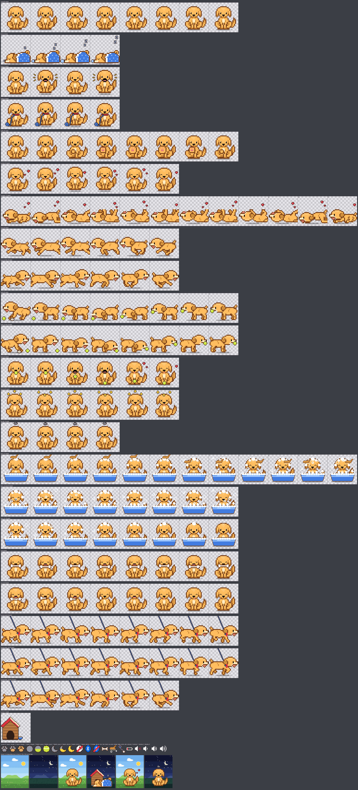
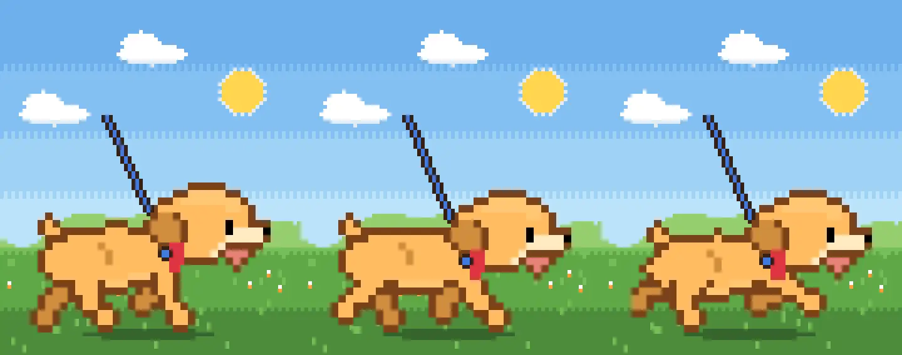

# How the sprites are made

*[Version française](sprites.fr.md)*

Every image of the puppy is **generated by code**: `widgets/osampo/tools/gen_assets.py`
draws each pose pixel by pixel and writes the sprite sheets. Nobody edits a PNG by hand.
Changing a pose means changing the code and regenerating.



## Constraints of the board

- **Screen:** 240 × 284 pixels, 1.83". A pose is a **64 × 64 cell**, shown at ×3.
- **Sheets:** one horizontal strip per animation (`ui/sprites/<anim>.png`), 6 to 8 cells,
  played at 70 to 200 ms per cell.
- **Colors:** at most **16 colors per sheet** (checked by the generator), so the sheets
  stay small in flash.
- **Sounds:** mono, 16 kHz, 16-bit WAV, played on a small speaker. Each sound is kept
  whole: a short excerpt sounds like a saturated "click".

## Two puppies, one palette

- **Front view** (sitting, barking, paw on the screen, bath, bone…): derived from the
  sitting puppy of **strawheart** (*Animals and Tea*, CC-BY-SA 3.0). The 23 × 25 original
  is scaled ×2, then touched up pixel by pixel: eyes redrawn at cell resolution, mouth,
  tongue, paws, props, a soft ground shadow. These sheets stay under **CC-BY-SA 3.0**
  ([credits](../LICENSE-ASSETS.md)).
- **Side view** (sleeping, running after the ball, rolling, the walk): drawn from scratch
  in the generator. Only strawheart's palette is reused, so both views belong together.
  Photos and drawings of real dogs served as pose models; no pixels were copied.

## The walk: walk, trot, gallop

During a walk, the board counts your steps and the puppy follows your pace.



The walk cycle follows the principles of a pixel-art dog walk-cycle tutorial by
**Slynyrd**:

- **Legs straight on the ground, bent only in the air.** A planted leg is a straight line
  from shoulder or hip to the paw; the wrist folds back and the hock bends only while the
  leg swings forward.
- **The rump sits above the hind legs.** The hind legs stand under the rump, not under the
  belly; otherwise the puppy looks like it is dragging something.
- **The hind leg pushes far back.** A planted hind leg starts under the hip and pushes
  8 pixels behind the rump before it lifts. A shorter stroke looks like a stiff leg.
- **Gaits:** walk = four beats (each leg in turn); trot = diagonal pairs; gallop = the
  side-view running cycle, also used when the puppy chases the ball.

Each choice above was made by comparing variants side by side, as a video and a contact
sheet, on the real board.

## Regenerate

```sh
python3 -I widgets/osampo/tools/gen_assets.py     # prints "TOUT OK"
```

Needs Python 3 with Pillow and NumPy. The script rewrites `ui/sprites/*.png`,
`sounds/*.wav` and `tools/planche_contact.png`, and checks frame counts, cell sizes,
color counts and sound levels. Then rebuild the firmware (`idf.py build`).

To change a gait, edit `ALLURES`, `MARCHE_X0` and `marche_pied()` (walk and trot) or
`COURT` (gallop) in the generator.
